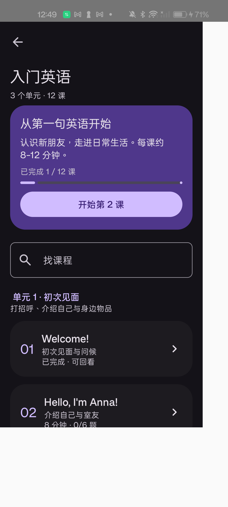
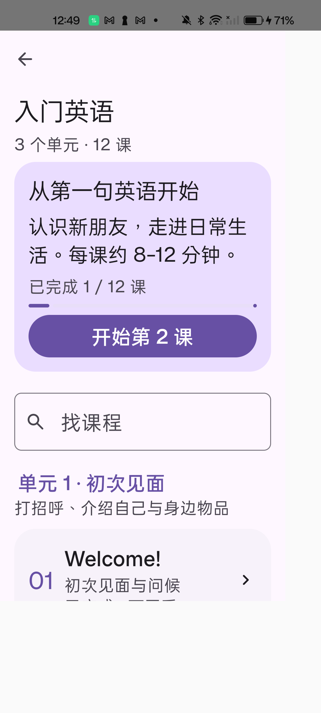
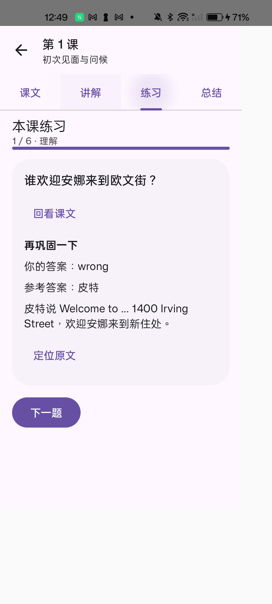

# 入门英语 12 课 DEV 交付

旧 60 课已由版本化 VOA 入门英语内容包替换：三个单元、287 个双语句段、96 个重点词句、24 个表达要点、72 道固定练习。包含目标、先修、技能、原始来源、媒体摘要、答案、中文解析与原文定位。内容制作及来源边界见 [课程说明](../../COURSE_CONTENT.md)，逐课答案及媒体校对见 [校对清单](content-checklist.md)。

课文、讲解、练习、总结可自由切换；原声按课下载并校验，整课/句段播放、循环、倍速、高亮、跟随滚动及本机跟读录音已实现。题目、草稿、浏览及播放位置、错题保存在独立短课表中。旧课程专属数据清理不写入背词记录。浮动导航源码未改动。

## 检查状态

- 169 项 JVM 单元测试通过；Debug、压缩 Release 构建和两者完整 lint 通过。Kotlin 分析器曾出现缓存异常，使用独立检查进程复验通过，没有禁用检查项。
- 12 个原始 MP3 的字节数、SHA-256、ffprobe 时长通过检查；课程包确定性重建与摘要检查通过。音频总计 9,898,726 字节，全部在安装包外。
- 词书静态服务 3 项、课程静态服务 2 项测试通过，覆盖 Range、HEAD、媒体类型与路径隔离。
- 一加 LE2101 真机课程验收 14 项通过：实际 HTTPS 原声下载及离线读取、下载中断续传、校验失败重试、缺音频听写草稿、保存与重复提交隔离、错题重练、句段循环和倍速、自动跟随滚动、后台暂停且不自动恢复、录音保存/回听/删除、小屏多主题与键盘大字体布局。
- 原有流程的 45 项真机回归通过：浮动导航、顶层返回、预测返回、设置、背词暂停续学和页面底部布局。浮动导航源码保持原样。
- 播放器 Prepared 状态错误循环已修复并通过损坏音频和切换标签回归；回听误调用录音启动的问题已修复，真实录音经媒体时长核验，切换后台后仍能保留并删除。测试录音已删除。
- 压缩验证版已在同一真机并排安装启动，学习首页实际显示 0 / 12 课，确认压缩后课程 JSON 与 Gson 模型可加载。默认下载改用摘要一致的 VOA Akamai CDN；十二份 CDN 文件均在本地逐一核对，手机实际下载第一课及离线重开通过。网页原始音频地址保留在 `audio.sourceUrl`，总下载超时限制为 60 秒。
- 没有使用模拟器，没有部署阿里云，没有创建或替换版本发布。版本仍为 1.2.2-rc.1，测试 APK 使用独立应用标识，与正式应用的数据分开。

## 安装包体积

本轮 Debug 28,431,452 字节（27.11 MiB）；压缩验证包 4,330,436 字节（4.13 MiB）。已发布 RC1 为 4,304,994 字节（4.11 MiB），压缩验证包增加 25,442 字节，约 24.85 KiB。此对比列实际 APK 大小；验证包包含独立安装标识并使用测试签名，和正式 RC 签名配置不同，不是正式发布包。已检查 APK 中包含课程 JSON、不包含 MP3 或新增语音模型/大型 SDK。

## 本地交付物

位于忽略目录 `validation/course-rebuild/delivery`：调试 APK、压缩验证 APK、12 课内容 ZIP、原声服务器归档和 SHA256SUMS。完整当前工作区备份在 `validation/course-rebuild/baseline-20261105-101010.zip`，不是已提交历史的替代备份。测试日志和来源快照保存在该验证目录。

服务器源文件位于 `server/courses`，可在本地生成并运行只读镜像，未来域名就绪后再配置 HTTPS。默认客户端使用 VOA 原始 HTTPS，不依赖尚未上线的阿里云服务。

## 真机复验

已在解锁真机上完成最终 Debug、AndroidTest 包的课程验证。复验时运行 `CourseMediaTest`、`CoursePersistenceTest`、`CourseContentDeviceTest`、`CourseScreensTest`，加参数 `-e verifyCourseCdn true` 才启用依赖外网的真实下载测试。普通测试默认跳过该外网项，避免把网络可达性作为所有测试的前提。页面截图输出到测试应用 `files/course-rebuild`；下方为最终验收中的测试数据样例。

