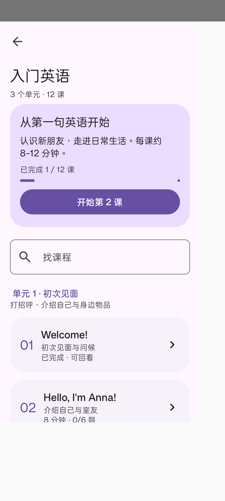
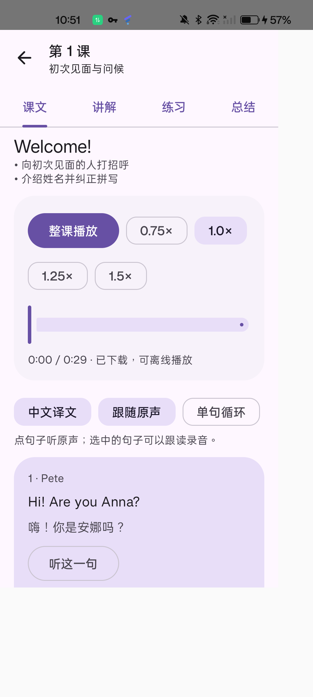

# 入门英语 12 课 DEV 交付

旧 60 课已由版本化 VOA 入门英语内容包替换：三个单元、287 个双语句段、96 个重点词句、24 个表达要点、72 道固定练习。包含目标、先修、技能、原始来源、媒体摘要、答案、中文解析与原文定位。内容制作及来源边界见 [课程说明](../../COURSE_CONTENT.md)，逐课答案及媒体校对见 [校对清单](content-checklist.md)。

课文、讲解、练习、总结可自由切换；原声按课下载并校验，整课/句段播放、循环、倍速、高亮、跟随滚动及本机跟读录音已实现。题目、草稿、浏览及播放位置、错题保存在独立短课表中。旧课程专属数据清理不写入背词记录。浮动导航源码未改动。

## 检查状态

- 169 项 JVM 单元测试通过；Debug、压缩 Release 构建和两者完整 lint 通过。Kotlin 分析器曾出现缓存异常，使用独立检查进程复验通过，没有禁用检查项。
- 12 个原始 MP3 的字节数、SHA-256、ffprobe 时长通过检查；课程包确定性重建与摘要检查通过。音频总计 9,898,726 字节，全部在安装包外。
- 词书静态服务 3 项、课程静态服务 2 项测试通过，覆盖 Range、HEAD、媒体类型与路径隔离。
- 真机首轮：音频中断续传、校验失败重试、离线命中、课程记录与内容加载通过；目录的浅色、深色、纯黑、动态配色及 1.5 倍字体，以及课文首屏已取得样例截图。
- **真机验收未完成。** 切换标签发现 Prepared 状态调用 pause 及错误回调递归问题，旧测试运行期间手机重启。源码已修正：未开始播放时不调用原生 pause，错误回调不再调用 pause，并为失效播放器回调增加实例检查。已添加准备后暂停、损坏音频、循环、倍速及后台暂停回归测试。手机重启后尚未首次解锁，因此修复后测试不能启动；不能将未完成的播放、滚动、键盘、错题页面及设置导航复验列为通过。录音流程也需解锁后补验。
- 没有使用模拟器，没有部署阿里云，没有创建或替换版本发布。版本仍为 1.2.2-rc.1，测试 APK 使用独立应用标识，与正式应用的数据分开。

## 安装包体积

本轮 Debug 28,431,452 字节（27.11 MiB）；压缩验证包 4,330,288 字节（4.13 MiB）。已发布 RC1 为 4,304,994 字节（4.11 MiB），压缩验证包增加 25,294 字节，约 24.7 KiB。此对比列实际 APK 大小；验证包包含独立安装标识并使用测试签名，和正式 RC 签名配置不同，不是正式发布包。已检查 APK 中包含课程 JSON、不包含 MP3 或新增语音模型/大型 SDK。

## 本地交付物

位于忽略目录 `validation/course-rebuild/delivery`：调试 APK、压缩验证 APK、12 课内容 ZIP、原声服务器归档和 SHA256SUMS。完整当前工作区备份在 `validation/course-rebuild/baseline-20261105-101010.zip`，不是已提交历史的替代备份。测试日志和来源快照保存在该验证目录。

服务器源文件位于 `server/courses`，可在本地生成并运行只读镜像，未来域名就绪后再配置 HTTPS。默认客户端使用 VOA 原始 HTTPS，不依赖尚未上线的阿里云服务。

## 真机复验

手动首次解锁手机后，安装最终 Debug 和 AndroidTest 包，运行 `CourseMediaTest`、`CoursePersistenceTest`、`CourseContentDeviceTest`、`CourseScreensTest`。先单独验证正常播放和损坏音频错误处理，再跑页面样例与原有导航、设置、背词流程。最终测试截图输出到测试应用 `files/course-rebuild`；下方图片是首轮页面样例，不代表修复后全部流程通过。

